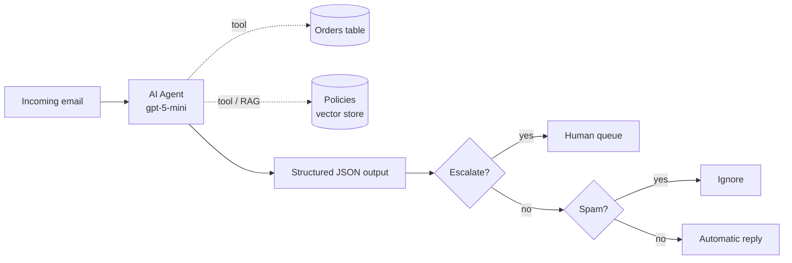

# AI Customer Support Agent (n8n + RAG + Evals)

An AI agent that triages customer support emails for **TechCasa**, a fictional Portuguese online electronics store. It classifies each email, extracts structured data, decides when a human needs to step in, and drafts a reply grounded in real order data and store policies.

## What it does

- **Classifies** emails into six categories (orders, returns, technical, information, complaints, spam) and **extracts** customer name, order number, urgency and a summary as JSON.
- **Escalates to a human** based on explicit business rules: legal or public complaint threats, refunds above €200, or repeated unanswered contacts.
- **Uses two tools:** an order lookup (status, delivery date, carrier) and a RAG search over the store policies (warranty, returns, shipping, payments, troubleshooting).
- **Routes** the result: escalated emails go to a human queue, spam is ignored, and the rest get an automatic reply.

## Architecture

## Evaluation

Tested on 12 emails, including edge cases such as refunds above the escalation limit, orders that don't exist, cancelled orders and angry customers that don't meet any escalation rule.

| Metric | Result |
|---|---|
| Category | 12/12 |
| Escalation decision | 12/12 |
| Order tool used when needed | 12/12 |
| Policy tool used when needed | 7/7 |

Every reply was also reviewed manually to confirm it only uses information from the email, the orders table or the policies, with no invented policies, deadlines or promises.

## Tech stack

n8n (self-hosted with Docker) · OpenAI `gpt-5-mini` and `text-embedding-3-small` · n8n AI Agent · RAG with Simple Vector Store · Structured Output Parser · n8n Data tables · n8n Evaluations

## How to run

1. Run n8n with Docker and import `classificador-emails-v3.json`.
2. Add your OpenAI credential, create the Data tables and import the CSV files.
3. Run the manual trigger once to load `politicas_techcasa.md` into the vector store.

All data in this project is fictional.

---

Built by João as part of my AI Engineering portfolio.
